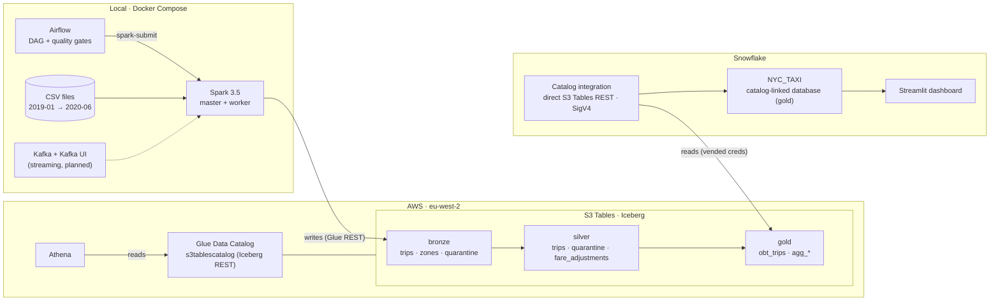

# NYC Taxi Lakehouse
 
An end-to-end lakehouse built on **Apache Iceberg**: PySpark builds a medallion pipeline (bronze → silver → gold) into **Amazon S3 Tables**, **Airflow** orchestrates it with data-quality gates, and **Athena** and **Snowflake** both query the same Iceberg tables in place, with no copies and no loading step. All infrastructure is defined in **Terraform**.
 
**Data:** NYC TLC Yellow Taxi trips, January 2019 to June 2020 (18 monthly files, **101,246,797 rows**), plus the taxi zone lookup.
---
Before running anything update the `/conf/spark-defaults.conf` file with your aws account and create the `.env` file
Unzip the data.zip file in `data/raw` folder and zones data will go into the `reference` folder
---
 
## Architecture
 

 
### Design principles
 
- **Single writer.** Spark is the only engine that writes. Athena and Snowflake are read-only consumers, so there are no concurrent-writer conflicts on the Iceberg tables.
- **Open table format, any engine.** Spark, Athena and Snowflake read the same Iceberg snapshot of the same Parquet files. Row counts match exactly across engines.
- **Idempotent loads.** Every job writes with `overwritePartitions()`, so rerunning a month replaces it instead of duplicating it.
- **Nothing is silently dropped.** Bad rows are quarantined with a reason code, and every layer reconciles back to bronze.
- **Infrastructure as code.** The bucket, catalog, namespaces, IAM, Snowflake integration, linked database, warehouse and dashboard are all in Terraform.
---
 
## Tech stack
 
| Layer | Technology |
|---|---|
| Compute | PySpark 3.5.3 (Docker: master + worker) |
| Table format | Apache Iceberg 1.9.2 |
| Storage + catalog | Amazon S3 Tables, AWS Glue Data Catalog (Iceberg REST endpoint) |
| Orchestration | Apache Airflow 3 (standalone, Docker) |
| Query engines | Amazon Athena, Snowflake (catalog-linked database) |
| Dashboard | Streamlit in Snowflake |
| Infrastructure | Terraform (AWS + Snowflake providers) |
| Streaming (planned) | Kafka (KRaft) + Spark Structured Streaming |
 
---
 
## Data model
 
### Bronze: raw, typed, lineage-tagged
| Table | Description |
|---|---|
| `bronze.trips` | CSVs read with an explicit schema, plus `source_file`, `year`, `month` (from the file name) and `ingested_at`. Partitioned by file year and month |
| `bronze.trips_quarantine` | Rows that failed schema parsing, with the original raw line kept in `_corrupt` |
| `bronze.zones` | Taxi zone lookup (265 zones) |
 
### Silver: cleaned and validated
| Table | Description |
|---|---|
| `silver.trips` | Valid, deduplicated trips with derived columns and data-quality flags. Partitioned by **actual pickup month** |
| `silver.trips_quarantine` | Invalid trips with a `dq_reason`. Partitioned by source file month |
| `silver.fare_adjustments` | Negative-fare rows (refunds, disputes, reversals): valid records of a different kind, kept separate |
 
The full rule set and the evidence behind each rule are in **[rules.md](rules.md)**.
 
### Gold: serving layer
| Table | Grain | Purpose |
|---|---|---|
| `gold.obt_trips` | One row per trip | Wide table: zones joined (pickup and drop-off), codes decoded, time attributes, measures |
| `gold.agg_monthly_kpis` | Month | Trips, revenue, month-over-month and year-over-year change |
| `gold.agg_daily_borough` | Day × borough | Revenue with a rolling 7-day average (`rangeBetween`, calendar-correct) |
| `gold.agg_hourly_zone` | Zone × hour × weekday/weekend | Average trips per day, busiest-zone ranking (`dense_rank`) |
| `gold.agg_tips` | Borough × time band | Average and median tip %, share of no-tip trips (card payments only) |
 
**Modelling choice:** gold is a **one-big-table** rather than a star schema. With columnar storage and a single main fact, pre-joining avoids query-time joins and keeps the serving layer simple. Small dimensions (zones, decoded codes) are broadcast-joined once in the gold job.
 
---
 
## Key findings
 
- **COVID impact:** April 2020 had **237,993** trips against **7,433,139** in April 2019, a fall of roughly **97%**.
- **Cross-file trips:** **742,589** genuine, unique trips with a pickup on the **1st of the following month** were stored in the previous month's file. A naive "pickup must match file month" rule would have deleted them. They are kept and flagged `is_cross_file`.
- **Negative fares are mostly reversals:** about **86%** are disputes or no-charge reversals (payment types 3 and 4), so they're routed to `fare_adjustments` rather than treated as bad data.
- **Undocumented codes:** `VendorID = 4` (267,080 rows) and `RatecodeID = 99` (4,777 rows) aren't in the 2019 data dictionary. They're decoded as "Unknown" rather than dropped.
### Bronze baseline (rows per source month)
 
| Month | 2019 | 2020 |
|---|---:|---:|
| Jan | 7,667,792 | 6,405,008 |
| Feb | 7,019,375 | 6,299,354 |
| Mar | 7,832,545 | 3,007,292 |
| Apr | 7,433,139 | 237,993 |
| May | 7,565,261 | 348,371 |
| Jun | 6,941,024 | 549,760 |
| Jul | 6,310,419 | |
| Aug | 6,073,357 | |
| Sep | 6,567,788 | |
| Oct | 7,213,891 | |
| Nov | 6,878,111 | |
| Dec | 6,896,317 | |
| **Total** | **84,399,019** | **16,847,778** |
 
---
 
## Orchestration
 
The Airflow DAG `nyc_taxi_pipeline` runs four Spark jobs in strict order:
 
```
ingest_bronze → silver_trips → gold_obt → gold_aggregates
```
 
- **Quality gates:** silver raises an error if `bronze ≠ clean + quarantine + adjustments + duplicates`, gold raises one if its row count differs from silver's, and the aggregates job checks that its totals match the big table. A failed gate stops the DAG, so downstream tasks are marked `upstream_failed` and **gold keeps the last good data**.
- **Execution:** each task runs `spark-submit` against the Spark cluster through `docker exec`. In production this would be an EMR Serverless operator; the DAG shape stays the same.
---
 
## Serving
 
### Athena
Queries the tables through the Glue federated catalog `s3tablescatalog/nyc-taxi-iceberg-bucket`.
 
### Snowflake
- **Catalog integration** to the **S3 Tables Iceberg REST endpoint directly** (`CATALOG_API_TYPE = AWS_S3TABLES`), using SigV4 and **catalog-vended credentials**. No external volume and no stored keys.
- **Catalog-linked database** `NYC_TAXI`, limited to the `gold` namespace. New snapshots written by Spark appear automatically.
- **Verified:** row counts in Snowflake and Athena are identical.
```sql
SELECT "pu_borough", COUNT(*) AS trips
FROM NYC_TAXI."gold"."obt_trips"
GROUP BY 1 ORDER BY 2 DESC;
```
 
### Dashboard
A Streamlit-in-Snowflake app over the gold aggregates (KPIs, monthly trend, revenue by borough, hourly demand, tipping), deployed by Terraform. It checks that gold has data before rendering, so it shows a clear message instead of a SQL error when the pipeline hasn't run yet.
 
---
 
## Security
 
| Identity | Purpose | Permissions |
|---|---|---|
| `tf-admin` (profile) | Runs Terraform | Admin: creates infrastructure and IAM |
| `s3_lakehouse_user` | Used by Spark | Glue catalog + S3 Tables read/write on this bucket only; **can't change IAM** |
| `snowflake-s3tables-read` (role) | Assumed by Snowflake | **Read-only** S3 Tables access; trusted only by this Snowflake integration (user ARN + external ID) |
| `TERRAFORM_SVC` (Snowflake) | Terraform and Snowflake CLI | Service user, key-pair authentication, no password login |
 
- **IAM-only catalog mode** (`IAM_ALLOWED_PRINCIPALS`): with a single writer and a read-only consumer, plain IAM is enough. Lake Formation is the upgrade path if row- or column-level security or cross-account sharing is needed.
- **No secrets in Git:** `.env`, Terraform state and private keys are git-ignored, and `.env.example` documents the variables.
- **No outbound access from the dashboard:** it uses only Snowflake's pre-installed packages, with no external access integration.
---
 
## Repository structure
 
```
NYC_Taxi_analysis/
├── airflow/
│   ├── Dockerfile
│   └── dags/nyc_taxi_pipeline.py
├── apps/dashboard/                 # Streamlit in Snowflake app
│   ├── streamlit_app.py
│   └── pyproject.toml
├── conf/
│   ├── spark-defaults.conf.tpl     # rendered from .env at container start
│   └── render-conf.sh
├── data/raw/                       # git-ignored
├── notebooks/                      # exploration
├── src/nyc_taxi_analysis/jobs/
│   ├── ingest_bronze.py
│   ├── silver_trips.py
│   ├── gold_obt.py
│   └── gold_aggregates.py
├── terraform/                      # AWS + Snowflake infrastructure
├── tests/
├── docker-compose.yml
├── rules.md                        # data-quality rules and evidence
└── README.md
```
 
---
 
## Running it
 
### Prerequisites
Docker Desktop (8 GB+ memory), Terraform, the AWS CLI with a `tf-admin` profile, a Snowflake account with key-pair auth for `TERRAFORM_SVC`, the Snowflake CLI (`snow`), and the NYC TLC CSVs in `data/raw/`.
 
### 1. Configure
```bash
cp .env.example .env    # AWS keys for s3_lakehouse_user, region, account ID, bucket
```
 
### 2. Provision infrastructure
```bash
cd terraform
terraform init
terraform apply -var-file=vars.tfvars    # runs as tf-admin
```
 
### 3. Start the platform
```bash
docker compose up -d --build
```
| Service | URL |
|---|---|
| Spark master UI | http://localhost:8080 |
| Spark job UI | http://localhost:4040 |
| Airflow | http://localhost:8090 |
| Kafka UI (`--profile streaming`) | http://localhost:8085 |
 
### 4. Run the pipeline
Trigger `nyc_taxi_pipeline` in Airflow, or run a single job:
```bash
docker compose exec spark-master /opt/spark/bin/spark-submit \
  --master spark://spark-master:7077 src/nyc_taxi_analysis/jobs/ingest_bronze.py
```
 
### 5. Validate
```sql
-- Athena (database: gold) and Snowflake should return the same number
SELECT COUNT(*) FROM obt_trips;                       -- Athena
SELECT COUNT(*) FROM NYC_TAXI."gold"."obt_trips";     -- Snowflake
```
 
---
 
## Lessons learned
 
| Problem | Cause | Fix |
|---|---|---|
| `Stage create is not supported` on `createOrReplace()` | The Glue Iceberg REST catalog doesn't support atomic create-and-write | Create the table explicitly (`CREATE TABLE IF NOT EXISTS`), then `overwritePartitions()`, which is also idempotent |
| `pickup_hour` 4 hours off | Session timezone `America/New_York` converted NYC wall-clock times a second time | Run Spark in **UTC** and treat timestamps as wall-clock local time |
| 100.9M rows quarantined as "out of range" | Offset rule missing `0` in `isin(-1, 0, 1)` | Fixed. The reconciliation gate is what caught it |
| Airflow ran all tasks at once | Dependencies weren't registered | Check with `airflow dags show <dag_id>` before triggering |
| Spark jobs kept running after cancelling in Airflow | `docker exec` doesn't propagate the kill | `pkill -f SparkSubmit` locally; use an operator that cancels remote jobs in production |
| Airflow database read-only | Container ran as `root`, the CLI as `airflow` | Run as the `airflow` user (which is in group 0, so it can use the Docker socket) |
| Terraform `AccessDenied` on IAM | Terraform was running as the data user | Separate identities: `tf-admin` for infrastructure, `s3_lakehouse_user` for data |
| Streamlit couldn't install packages | Trial accounts block external access, so no PyPI | Use the runtime's pre-installed packages with Snowflake's unmodified `pyproject.toml` template |
 
---
 
## Roadmap
 
- [ ] **Streaming:** Kafka → Spark Structured Streaming → append to `bronze.trips` (batch and streaming writing into one lakehouse)
- [ ] **Incremental, parameterised runs:** one month per DAG run using Airflow's logical date; backfills
- [ ] **Performance:** skew handling (salting compared with AQE), partition and file-size tuning, Spark UI benchmarks
- [ ] **Tests:** pytest + chispa unit tests for transformations
- [ ] **Cloud batch:** move the jobs to EMR Serverless; only configuration changes
- [ ] **Semantic layer:** Cube over Snowflake
- [ ] **Fine-grained access:** Lake Formation column and row security
 

### smoke test 
docker compose exec spark-master /opt/spark/bin/spark-submit \
  --master spark://spark-master:7077 \
  src/nyc_taxi_analysis/jobs/smoke_test.py


  