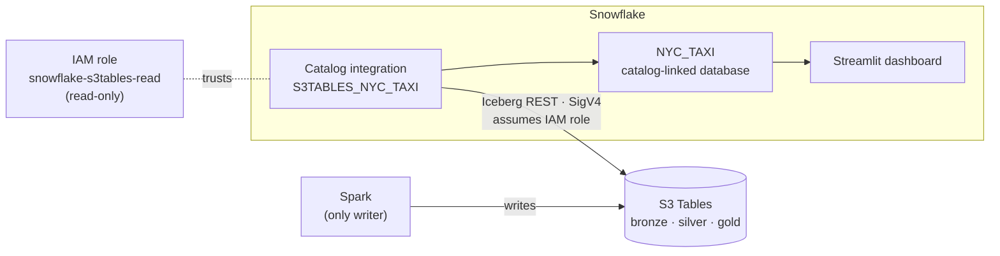

# Snowflake Setup

How Snowflake reads the lakehouse's gold tables **in place** from Amazon S3 Tables (Iceberg), with no data copy and no stored credentials. Everything below except the one-off key setup is created by Terraform.

---

## How it connects



| Choice | Why |
|---|---|
| **Direct S3 Tables REST endpoint** (`CATALOG_API_TYPE = AWS_S3TABLES`), not Glue | The catalog runs in IAM-only mode. The Glue route depends on Lake Formation credential vending; the direct route needs only IAM |
| **Catalog-vended credentials** | AWS issues short-lived credentials per query. No external volume and no access keys stored in Snowflake |
| **Catalog-linked database, `gold` only** | Tables are discovered automatically and stay in sync; only the serving layer is exposed |
| **Read-only IAM role** | Spark stays the single writer, and Snowflake can't modify the tables |

---

## Prerequisites

- A Snowflake account on **AWS**, ideally in **`AWS_EU_WEST_2`** to match the bucket (`SELECT CURRENT_REGION();`)
- AWS infrastructure already applied (table bucket, `s3tablescatalog`, namespaces)
- Terraform, the AWS CLI with the `tf-admin` profile, and the Snowflake CLI (`uv tool install snowflake-cli`)

---

## 1. One-off: service user and key pair

**Generate the key pair** (on your machine; never commit it):
```bash
mkdir -p ~/.snowflake && cd ~/.snowflake
openssl genrsa 2048 | openssl pkcs8 -topk8 -inform PEM -out terraform_svc.p8 -nocrypt
openssl rsa -in terraform_svc.p8 -pubout -out terraform_svc.pub
chmod 600 terraform_svc.p8
grep -v "PUBLIC KEY" terraform_svc.pub | tr -d '\n'   # copy this
```

**Create the service user** (worksheet, as `ACCOUNTADMIN`):
```sql
CREATE USER TERRAFORM_SVC
  TYPE = SERVICE
  RSA_PUBLIC_KEY = '<paste public key>'
  DEFAULT_ROLE = ACCOUNTADMIN;

GRANT ROLE ACCOUNTADMIN TO USER TERRAFORM_SVC;
```
`TYPE = SERVICE` means the user can't log in with a password, only with the key.

**Optional: check the key fingerprint matches:**
```sql
DESC USER TERRAFORM_SVC;   -- RSA_PUBLIC_KEY_FP
```
```bash
openssl rsa -in ~/.snowflake/terraform_svc.p8 -pubout -outform DER \
  | openssl dgst -sha256 -binary | openssl enc -base64
```

---

## 2. One-off: Snowflake CLI connection

Used by Terraform to upload the dashboard files.
```bash
snow connection add
#   name:          terraform
#   account:       <ORG>-<ACCOUNT>
#   user:          TERRAFORM_SVC
#   authenticator: SNOWFLAKE_JWT
#   private key:   /Users/<you>/.snowflake/terraform_svc.p8   (full path, not ~)
#   role:          ACCOUNTADMIN
#   warehouse:     DASH_WH

snow connection test -c terraform    # expect Status: OK
```

---

## 3. Terraform variables

`terraform/vars.tfvars`:
```hcl
snowflake_org              = "<ORG>"
snowflake_account          = "<ACCOUNT>"
snowflake_user             = "TERRAFORM_SVC"
snowflake_private_key_path = "~/.snowflake/terraform_svc.p8"
```

Provider (`terraform/provider.tf`):
```hcl
provider "snowflake" {
  organization_name = var.snowflake_org
  account_name      = var.snowflake_account
  user              = var.snowflake_user
  authenticator     = "SNOWFLAKE_JWT"
  private_key       = file(var.snowflake_private_key_path)
  role              = "ACCOUNTADMIN"
}
```

---

## 4. What Terraform creates

```bash
cd terraform
export AWS_PROFILE=tf-admin          # creating IAM roles needs admin
terraform apply -var-file=vars.tfvars
```

| Order | Resource | Purpose |
|---|---|---|
| 1 | `S3TABLES_NYC_TAXI` catalog integration | Points Snowflake at the S3 Tables REST endpoint using a **predictable role ARN** (the role doesn't exist yet) |
| 2 | `DESC CATALOG INTEGRATION` | Returns `API_AWS_IAM_USER_ARN` and `API_AWS_EXTERNAL_ID` |
| 3 | IAM role `snowflake-s3tables-read` | Trust policy uses those two values, so only this integration can assume it |
| 4 | `NYC_TAXI` catalog-linked database | `ALLOWED_NAMESPACES = ('gold')`; created after the role works |
| 5 | `DASH_WH`, `APPS.DASHBOARDS`, stage, Streamlit app | The dashboard |

Constructing the role ARN up front breaks the circular dependency (the integration needs the role, and the role needs the integration), so the whole setup completes in **one apply**.

The integration and linked database use `snowflake_execute` (plain SQL), because the provider's native resources don't reliably support SigV4 with `AWS_S3TABLES`.

---

## 5. Test the integration

Run in order; each step isolates one possible failure.

```sql
-- 1. Authentication (IAM role + trust policy)
SELECT SYSTEM$VERIFY_CATALOG_INTEGRATION('S3TABLES_NYC_TAXI');

-- 2. Catalog visibility
SELECT SYSTEM$LIST_NAMESPACES_FROM_CATALOG('S3TABLES_NYC_TAXI');

-- 3. Tables in gold
SELECT SYSTEM$LIST_ICEBERG_TABLES_FROM_CATALOG('S3TABLES_NYC_TAXI', 'gold');

-- 4. Linked database sync
SELECT SYSTEM$CATALOG_LINK_STATUS('NYC_TAXI');
SHOW ICEBERG TABLES IN DATABASE NYC_TAXI;

-- 5. Data matches Athena
SELECT COUNT(*) FROM NYC_TAXI."gold"."obt_trips";
```
The count in step 5 must equal `SELECT COUNT(*) FROM obt_trips` in Athena (database `gold`). Both engines read the same Iceberg snapshot.

**Freshness test:** rerun the Airflow DAG, wait about a minute, and query again. The new snapshot appears with no manual refresh.

---

## 6. Querying

Iceberg names are **lowercase**, and Snowflake uppercases unquoted identifiers, so always **double-quote** schemas, tables and columns:

```sql
SELECT "pu_borough", COUNT(*) AS trips, ROUND(AVG("total_amount"), 2) AS avg_total
FROM NYC_TAXI."gold"."obt_trips"
GROUP BY 1
ORDER BY 2 DESC;
```

---

## 7. Dashboard (Streamlit in Snowflake)

Snowsight dashboards were retired in 2026; Streamlit in Snowflake is the native replacement.

| File | Purpose |
|---|---|
| `apps/dashboard/streamlit_app.py` | The app: KPIs, monthly trend, revenue by borough, hourly demand, tipping |
| `apps/dashboard/pyproject.toml` | **Snowflake's default template, unmodified** |

Terraform uploads both files with `snow stage copy` and recreates the app whenever either file's hash changes:
```sql
CREATE OR REPLACE STREAMLIT APPS.DASHBOARDS.NYC_TAXI_DASHBOARD
  FROM '@APPS.DASHBOARDS.STREAMLIT_STAGE/nyc_taxi'
  MAIN_FILE = 'streamlit_app.py'
  COMPUTE_POOL = SYSTEM_COMPUTE_POOL_CPU
  QUERY_WAREHOUSE = DASH_WH
  TITLE = 'NYC Taxi Lakehouse';
```

**Trial account constraints:**
- **External access isn't supported on trials**, so the app can't download packages from PyPI.
- The **container runtime** falls back to the **pre-installed Streamlit and Snowpark** only if `pyproject.toml` is Snowflake's **unmodified template**. Any edit makes it require PyPI and fail.
- So the app uses only pre-installed libraries. Adding packages needs a paid account with an external access integration, or an artifact repository.

**Readiness check:** the app checks that gold exists and has rows before rendering, and shows a message instead of a SQL error if the pipeline hasn't run yet.

Open it under **Snowsight → Projects → Streamlit → NYC Taxi Lakehouse**.

---

## Troubleshooting

| Error | Cause | Fix |
|---|---|---|
| `VERIFY_CATALOG_INTEGRATION` fails / `AssumeRole` denied | Trust policy doesn't match the `DESC` output, or IAM hasn't propagated | Run `terraform apply` again after about 30 seconds |
| `Invalid index "API_AWS_IAM_USER_ARN"` in Terraform | The `DESC` property names differ | Check the names with `DESC CATALOG INTEGRATION` and update the keys |
| Object `"gold"."obt_trips"` does not exist | Pipeline hasn't run, or identifiers weren't quoted | Run the DAG; use double quotes |
| `not authorized` when querying | Role policy is missing `s3tables:GetTableData` | Add it to the role policy |
| `iam:CreateRole` AccessDenied | Terraform running as the data user | `export AWS_PROFILE=tf-admin` and unset `AWS_ACCESS_KEY_ID` |
| `snow: command not found` | CLI not on PATH | Use the full path from `which snow` in Terraform |
| `Connection terraform is not configured` | CLI connection missing | `snow connection add` |
| `External access is not supported for trial accounts` | EAI or PyPI on a trial | Remove the EAI; use the unmodified `pyproject.toml` template |
| `Runtime {0} is not valid` | Runtime name not available on this account | Remove `RUNTIME_NAME`; set `COMPUTE_POOL` |
| `pyproject.toml file does not exist` | Account defaults to the container runtime | Upload Snowflake's template `pyproject.toml` |

---

## Key rotation

```sql
ALTER USER TERRAFORM_SVC SET RSA_PUBLIC_KEY_2 = '<new public key>';
-- switch Terraform and the CLI to the new .p8, then:
ALTER USER TERRAFORM_SVC UNSET RSA_PUBLIC_KEY;
```

---

## Teardown

```bash
terraform destroy -var-file=vars.tfvars
```
Removes the Streamlit app, warehouse, linked database, catalog integration and IAM role. **Data in S3 Tables is unaffected.** Snowflake only reads it; the AWS teardown is covered in the main README.